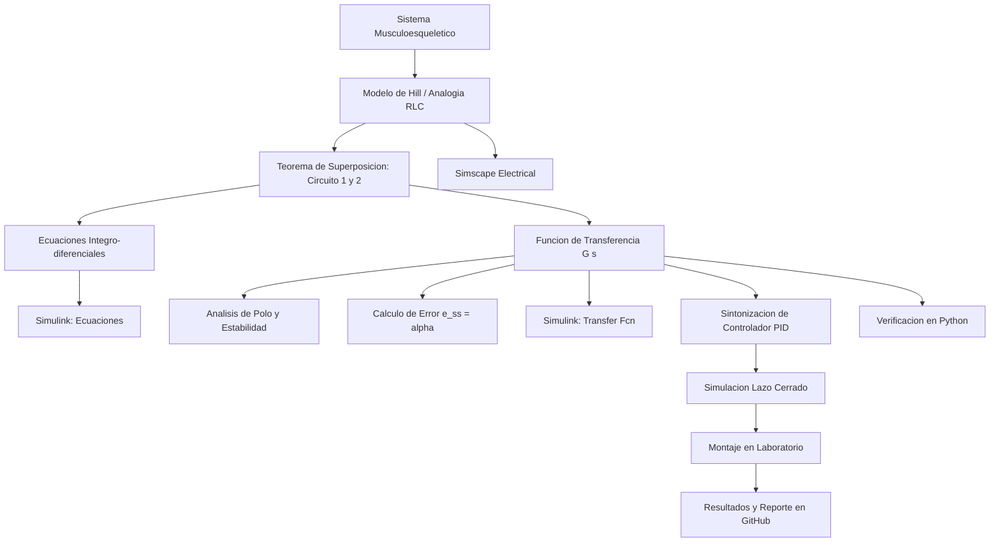

[](https://matlab.mathworks.com/open/github/v1?repo=PradoIT/MSFP3)

# Práctica 3 — Modelado y control del Sistema Musculoesquelético

Repositorio académico de la asignatura **Modelado de Sistemas Fisiológicos**, correspondiente al programa de **Ingeniería Biomédica** del Tecnológico Nacional de México / Instituto Tecnológico de Tijuana. Esta práctica integra modelado matemático, analogías eléctricas y mecánicas de sistemas fisiológicos, análisis temporal y de estabilidad del tejido muscular, diseño de controladores PID, simulación computacional y comprobación experimental.

El caso de estudio representa la dinámica de la fuerza en el **sistema musculoesquelético** mediante la combinación por superposición de dos subcircuitos analógicos que consideran la compliancia en serie ($C_s$), la compliancia en paralelo ($C_p$), la resistencia pasiva muscular ($R$) y una fuente dependiente de fuerza activa ($\alpha F(t)$). Se busca reproducir y comparar la respuesta de la fuerza muscular total $F_s(t)$ ante diferentes señales de entrada de excitación $F(t)$, tanto en lazo abierto como en lazo cerrado con un controlador PID.

**Docente:** Dr. Paul Antonio Valle Trujillo  
**Correo:** paul.valle@tectijuana.edu.mx  
**Departamento:** Ingeniería Eléctrica y Electrónica  
**Institución:** Tecnológico Nacional de México / Instituto Tecnológico de Tijuana  
**Asignatura:** Modelado de Sistemas Fisiológicos  
**Programa:** Ingeniería Biomédica  
**Estudiante:** Prado Acosta Briseida · l23210715 · l23210715@tijuana.tecnm.mx

**Repositorio de la asignatura:** https://github.com/DrPaulValle/MSF-IBF1020  
**Sede:** Blvd. Alberto Limón Padilla s/n, Tijuana, C. P. 22454, B. C., México.

---

<a id="contenido"></a>
## Contenido

1. [Resumen](#resumen)
2. [Competencia y objetivos](#objetivos)
3. [Relación con el temario](#temario)
4. [Modelo físico y analogía eléctrica](#analogia)
5. [Formulación matemática](#modelo)
6. [Análisis temporal y de estabilidad](#analisis)
7. [Señales de entrada y condiciones de simulación](#senales)
8. [Implementación en MATLAB, Simulink y Simscape](#matlab)
9. [Control en lazo cerrado y sintonización PID](#pid)
10. [Reproducción en Python](#python)
11. [Controlador analógico y laboratorio](#laboratorio)
12. [Resultados y verificación cruzada](#resultados)
13. [Flujo de trabajo](#flujo)
14. [Actividades del estudiante](#actividades)
15. [Estructura del repositorio](#estructura)
16. [Requisitos](#requisitos)
17. [Reproducibilidad y entregables](#reproducibilidad)
18. [Referencias](#referencias)

---

<a id="resumen"></a>
## Resumen

La práctica tiene como propósito **reproducir un procedimiento completo de modelado, análisis, simulación y control** del sistema musculoesquelético. La respuesta viscoelástica del músculo se aproxima mediante un modelo mecánico estructurado (modelo de Hill / Maxwell-Voigt modificado) representado a través de una analogía de circuitos pasivos y fuentes dependientes. Utilizando el **principio de superposición**, la respuesta total de fuerza $F_s(t)$ se descompone en dos contribuciones independientes: $F_{s1}(t)$ asociada a la fuerza de excitación $F(t)$ (Circuito 1) y $F_{s2}(t)$ asociada a la fuente dependiente de contracción activa $\alpha F(t)$ (Circuito 2).

A partir de las ecuaciones de mallas y nodos se deriva la función de transferencia de primer orden del sistema, se determina el error en estado estacionario y se analiza la estabilidad temporal del tejido muscular. Posteriormente se aplican cuatro entradas de referencia —escalón, pulso, rampa y senoide— y se contrastan las simulaciones numéricas en MATLAB/Simulink/Simscape con la implementación en Python y los registros de laboratorio. Finalmente, se sintoniza un **controlador PID con retroalimentación negativa** para garantizar una respuesta precisa en lazo cerrado.

**Palabras clave:** circuito RLC; controlador PID; sistema musculoesquelético; modelo matemático; simulaciones numéricas.
[Volver al contenido](#contenido)

---

<a id="objetivos"></a>
## Competencia y objetivos

### Competencia a desarrollar

Comprender y aplicar las propiedades de los modelos dinámicos de primer y segundo orden y el teorema de superposición en analogías eléctricas para describir la viscoelasticidad y la contracción del sistema musculoesquelético. La práctica permite diseñar estrategias de control retroalimentado sobre la fuerza muscular y evaluar su desempeño in silico y en laboratorio.

### Objetivo general

Obtener, simular y controlar el modelo matemático del sistema musculoesquelético representado por la suma de dos subcircuitos ($F_s(t) = F_{s1}(t) + F_{s2}(t)$), validando la función de transferencia en lazo abierto y lazo cerrado mediante MATLAB, Simulink, Python y pruebas de laboratorio.

### Objetivos específicos

- Formular el análisis por superposición apaga la fuente activa (Circuito 1) y la fuente de entrada (Circuito 2) para hallar $F_{s1}(s)$ y $F_{s2}(s)$.
- Obtener la función de transferencia global $G(s) = \frac{F_s(s)}{F(s)} = \frac{C_s R s + 1 - \alpha}{R(C_p + C_s)s + 1}$.
- Determinar las ecuaciones integro-diferenciales que rigen el comportamiento dinámico muscular.
- Evaluar el polo del sistema y realizar el análisis de estabilidad en lazo abierto.
- Determinar el error en estado estacionario ante entradas de referencia como el escalón unitario.
- Emular el circuito en Simulink y Simscape Electrical ante entradas escalón, pulso, rampa y senoide.
- Diseñar y sintonizar un controlador PID en lazo cerrado para eliminar el error en estado estacionario y optimizar la respuesta transitoria.
- Validar el modelo y su respuesta mediante un programa independiente en Python.

[Volver al contenido](#contenido)

---

<a id="temario"></a>
## Relación con el temario

La práctica integra contenidos correspondientes a tres unidades de la asignatura **Modelado de Sistemas Fisiológicos (IBF-1020)**:

| Unidad | Área | Contenidos aplicados |
|---|---|---|
| I | Sistemas de control retroalimentados | Diagramas de bloques, respuesta temporal, análisis de error y criterios de estabilidad |
| II | Modelado matemático | Analogía circuito–sistema musculoesquelético, principio de superposición, ecuaciones de mallas/nodos y función de transferencia |
| III | Controladores | Tipos de controladores, diseño del PID y sintonización de ganancias |

[Volver al contenido](#contenido)

---

<a id="analogia"></a>
## Modelo físico y analogía eléctrica

El sistema musculoesquelético combina elementos elásticos pasivos (tendones y fascia) con elementos contráctiles activos (sarcómeros). Se representa mediante el circuito analógico equivalente donde la fuerza muscular $F_s(t)$ se relaciona con corrientes/voltajes según la convención adoptada.

| Símbolo | Equivalente eléctrico | Interpretación fisiológica |
|---|---|---|
| $F(t)$ | Fuente de entrada | Fuerza de excitación / estímulo neural |
| $F_s(t)$ | Respuesta de salida | Fuerza muscular total resultante ($F_{s1} + F_{s2}$) |
| $R$ | Resistencia | Amortiguamiento viscoelástico / resistencia pasiva muscular |
| $C_s$ | Capacitancia en serie | Compliancia del elemento elástico en serie (tendón) |
| $C_p$ | Capacitancia en paralelo | Compliancia del elemento elástico en paralelo (teji conectivo pasivo) |
| $\alpha F(t)$ | Fuente dependiente | Contracción activa producida por el acoplamiento miosina-actina |

[Volver al contenido](#contenido)

---

<a id="modelo"></a>
## Formulación matemática

### 1. Análisis por superposición

La fuerza total en el dominio de Laplace es la suma de los dos estados:

$$F_s(s) = F_{s1}(s) + F_{s2}(s)$$

#### Circuito 1 (Apagando fuente dependiente $F_0(t) = \alpha F(t)$)
Al realizar el análisis de nodos y mallas para la primera componente de fuerza:

$$F_{s1}(s) = \frac{C_s R s + 1}{R(C_p + C_s)s + 1} F(s)$$

#### Circuito 2 (Apagando la entrada $F(t)$)
Al evaluar únicamente la contribución de la fuente dependiente de la contracción muscular $-\alpha F(t)$:

$$F_{s2}(s) = -\frac{\alpha}{R(C_p + C_s)s + 1} F(s)$$

### 2. Función de transferencia global

Sumando las contribuciones de ambos subcircuitos:

$$F_s(s) = \frac{C_s R s + 1}{R(C_p + C_s)s + 1} F(s) - \frac{\alpha}{R(C_p + C_s)s + 1} F(s)$$

$$\boxed{G(s) = \frac{F_s(s)}{F(s)} = \frac{C_s R s + 1 - \alpha}{R(C_p + C_s)s + 1}}$$

[Volver al contenido](#contenido)

---

<a id="analisis"></a>
## Análisis temporal y de estabilidad

### 1. Error en estado estacionario

Para una entrada de escalón unitario $F(s) = \frac{1}{s}$, aplicando el Teorema del Valor Final:

$$e_{ss} = \lim_{s \to 0} s F(s) [1 - G(s)] = \lim_{s \to 0} s \left(\frac{1}{s}\right) \left[ 1 - \frac{C_s R s + 1 - \alpha}{R(C_p + C_s)s + 1} \right]$$

$$\boxed{e_{ss} = 1 - (1 - \alpha) = \alpha}$$

El error en estado estacionario en lazo abierto depende directamente del coeficiente de activación muscular $\alpha$.

### 2. Polos y estabilidad

El polo del sistema se obtiene igualando a cero el denominador de la función de transferencia:

$$R(C_p + C_s)s + 1 = 0 \implies \boxed{s_1 = -\frac{1}{R(C_p + C_s)}}$$

Dado que los parámetros físicos del músculo $R > 0$, $C_p > 0$ y $C_s > 0$ son estrictamente positivos, el polo se ubica en el entreplano izquierdo del plano $s$ ($s_1 < 0$). Por lo tanto, **el sistema musculoesquelético es BIBO estable** de primer orden.

[Volver al contenido](#contenido)

---

<a id="senales"></a>
## Señales de entrada y condiciones de simulación

| Señal | Definición para la simulación | Propósito |
|---|---|---|
| Escalón | $u(t) = 1$ para $t \ge 0$ | Evaluar la respuesta a una contracción sostenida |
| Pulso | Amplitud $1$, duración $1\,\mathrm{s}$ | Evaluar la respuesta ante una sacudida muscular rápida (twitch) |
| Rampa | $u(t) = t/10$ | Simular el reclutamiento progresivo de fibras musculares |
| Senoide | $u(t) = \sin(\pi t / 2)$ | Simular el patrón de movimiento oscilatorio cíclico |

[Volver al contenido](#contenido)

---

<a id="matlab"></a>
## Implementación en MATLAB, Simulink y Simscape

Se realizan tres esquemas de implementación en el entorno MATLAB:
1. **Diagrama de bloques integro-diferencial en Simulink:** Representa la integración de los flujos y estados pasivo/activo del músculo.
2. **Función de transferencia:** Utilizando la función `tf` con los coeficientes del numerador $(C_s R s + 1 - \alpha)$ y denominador $(R(C_p + C_s)s + 1)$.
3. **Esquema de componentes en Simscape Electrical:** Modelado analógico con la superposición de mallas R-C.

[Volver al contenido](#contenido)

---

<a id="pid"></a>
## Control en lazo cerrado y sintonización PID

### 1. Retroalimentación negativa

Dado que en lazo abierto el error en estado estacionario es $e_{ss} = \alpha$, se implementa un controlador PID en lazo cerrado con retroalimentación negativa unitaria para anular esta desviación y garantizar que la fuerza muscular siga fielmente el comando de excitación de referencia.

### 2. Sintonización

Con la herramienta `PID Tuner` de Simulink se ajustan las ganancias $k_P$, $k_I$ y $k_D$ para cumplir con las especificaciones de desempeño:
- Tiempo de establecimiento $t_s \le 100\,\mathrm{ms}$
- Sobreimpulso $M_p \le 10\%$

[Volver al contenido](#contenido)

---

<a id="python"></a>
## Reproducción en Python

Mediante un script ejecutable en Python (`.py`), se define la función de transferencia $G(s)$, se calcula la posición del polo del sistema y se grafican las respuestas en lazo abierto y lazo cerrado comparándolas directamente con los resultados obtenidos en MATLAB.

[Volver al contenido](#contenido)

---

<a id="laboratorio"></a>
## Controlador analógico y laboratorio

### Materiales y equipo
- Resistores, capacitores y amplificadores operacionales (TL084 / LM358).
- Fuente de alimentación simétrica ($\pm 15\,\mathrm{V}$).
- Generador de funciones y osciloscopio para captura de respuestas en lazo abierto y lazo cerrado.

[Volver al contenido](#contenido)

---

<a id="resultados"></a>
## Resultados y verificación cruzada

Se organizan las evidencias gráficas obtenidas de las tres plataformas de prueba.

### Archivos de resultados

| Entrada | MATLAB/Simulink | Python | Laboratorio (Osciloscopio) |
|---|---|---|---|
| Escalón | `step_matlab.pdf` | `step_python.pdf` | `stepLC.pdf` |
| Pulso | `impulse_matlab.pdf` | `impulse_python.pdf` | `impulseLC.pdf` |
| Rampa | `ramp_matlab.pdf` | `ramp_python.pdf` | `rampLC.pdf` |
| Sinusoidal | `sinusoidal_matlab.pdf` | `sinusoidal_python.pdf` | `sinLC.pdf` |

[Volver al contenido](#contenido)

---

<a id="flujo"></a>
## Flujo de trabajo



[Volver al contenido](#contenido)

---

<a id="actividades"></a>
## Actividades del estudiante

- [x] Aplicar superposición para resolver el Circuito 1 y Circuito 2.
- [x] Obtener la función de transferencia global $G(s) = \frac{C_s R s + 1 - \alpha}{R(C_p + C_s)s + 1}$.
- [x] Calcular el error en estado estacionario ($e_{ss} = \alpha$).
- [x] Determinar la ubicación del polo y verificar la estabilidad del sistema.
- [ ] Implementar la simulación en Simulink y Simscape Electrical.
- [ ] Diseñar y sintonizar el controlador PID para eliminar el error $\alpha$.
- [ ] Reproducir las respuestas en lazo abierto y cerrado en Python.
- [ ] Montar el circuito analógico en protoboard y registrar las lecturas del osciloscopio.
- [ ] Subir código y archivos de resultados al repositorio de GitHub.

[Volver al contenido](#contenido)

---

<a id="estructura"></a>
## Estructura del repositorio

```text
.
├── README.md                           # Reporte principal y guía de la práctica
├── CITATION.cff                        # Fichero de citación
├── Prado_l23210715.mlx                 # Cuaderno de MATLAB
├── Prado_l23210715.pdf                 # Reporte exportado en PDF
├── sistema_musculoesqueletico.slx      # Modelo de Simulink/Simscape
├── sistema_musculoesqueletico.py       # Código en Python
├── controlador_pid.png                 # Parámetros del controlador
```

[Volver al contenido](#contenido)

---

<a id="requisitos"></a>
## Requisitos

### Software
- **MATLAB R2023a o superior** (Simulink, Simscape Electrical, Control System Toolbox).
- **Python 3.8+** (con `numpy`, `scipy`, `matplotlib`, `control`).
- **VS Code** .

### Recursos de laboratorio
- Instrumentación de laboratorio (Osciloscopio, Fuente simétrica, Generador de funciones).

[Volver al contenido](#contenido)

---

<a id="reproducibilidad"></a>
## Reproducibilidad y entregables

1. Clonar el repositorio: `git clone https://github.com/PradoIT/MSFP3.git`
2. Abrir el cuaderno `.mlx` en MATLAB y ejecutar todas las secciones.
3. Ejecutar el archivo `.py` en Python para verificar las respuestas temporales.
4. Comparar el comportamiento entre lazo abierto y lazo cerrado al variar el parámetro $\alpha$.

[Volver al contenido](#contenido)

---

<a id="referencias"></a>
## Referencias

[1] P. A. Valle, Syllabus para Modelado de Sistemas Fisiológicos, Tecnológico Nacional de México / Instituto Tecnológico de Tijuana, Tijuana, B.C., México, 2025. Permalink: https://biomath.xyz/course/

[2] M. C. Khoo, *Physiological Control Systems: Analysis, Simulation, and Estimation*, 2nd ed. Piscataway, New Jersey, USA: IEEE Press, 2018.

[3] N. S. Nise, *Control Systems Engineering*, 8th ed. Hoboken, New Jersey, USA: John Wiley & Sons, 2020.
